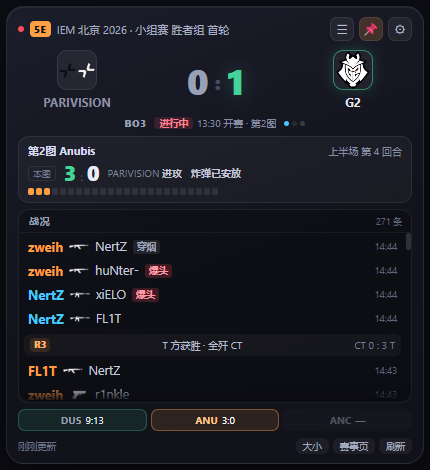
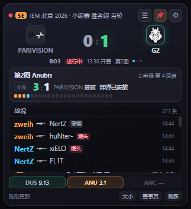
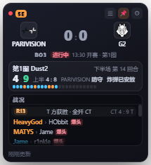

# 5E 比分桌面小组件

一个常驻桌面的小窗，实时显示 5EPlay 赛事的**大比分**、**当前地图小比分**，以及**逐条战况**（谁杀了谁、用什么武器、下包、拆包、回合结束）。数据直接取自 5E 赛事页（event.5eplay.com）前端使用的接口，不需要开浏览器挂着网页。



## 功能

- **大比分**：双方各赢下几张图，领先方高亮，队徽发光。
- **小比分**：当前地图回合比分，独立面板，带半场、攻防方、炸弹状态和回合色块。
- **战况事件流**：击杀 / 下包 / 拆包 / 回合结束逐条显示，可滚轮回翻历史。
- **选手数据总览**：K / D / A / ADR / Rating，★ 标出本场 MVP。
- **赛事切换**：列表分「已结束 / 进行中 / 未开始」三段，可跟随当前比赛，也可固定某一场。
- **三档尺寸**：大 / 中 / 小，中档不是等比缩放而是重新排版，保证字号可读。
- **主题与外观**：黑夜 / 白天主题、窗口透明度、圆角窗口、置顶。
- **托盘常驻**：单击隐藏、右键菜单、快捷键 `Ctrl+Alt+H` 显隐、`Ctrl+Alt+5` 切换尺寸。

## 快速开始

环境要求：Windows，Node.js 18 及以上。

```bash
git clone https://github.com/lingdiaoluo/5e-live-widget.git
cd 5e-live-widget
npm install
npm start
```

启动后窗口默认出现在屏幕右上角，置顶显示。

项目内还提供了启动脚本和快捷方式工具，方便不熟悉命令行的场景：

| 文件 | 用途 |
| --- | --- |
| `启动5E比分.bat` | 带日志窗口启动，排错时用 |
| `make-shortcut.js` | 在桌面生成带图标的快捷方式（托盘菜单里也有「创建桌面快捷方式」） |

## 界面分区

```
┌──────────────────────────────────────────────┐
│ ● 5E  IEM 北京 2026 · 小组赛 胜者组 首轮  ☰📌⚙ │
├──────────────────────────────────────────────┤
│   [队徽] Aurora        0 : 1        Liquid[队徽] │  ← ① 大比分：已赢下的地图数（36px）
│        BO3   ●进行中 12:30 开赛 · 第2图  ●●     │
├──────────────────────────────────────────────┤
│  第2图 Anubis                    上半场 第12回合 │  ← ② 小比分独立面板
│  [本图] 3 : 9   Aurora 进攻  炸弹已安放          │     （21px + 回合色块）
│  ▮▮▮▯▯▯▯▯▯▯▯▯                                 │
├──────────────────────────────────────────────┤
│  战况                                    414 条 │  ← ③ 事件流，可滚轮翻历史
│  ┌ R10 ── T 方获胜 · 炸弹爆炸 ── CT 2:8 T ┐    │
│  │ 下包  Jame  A 点 · 剩余 2v1             │    │
│  │ EliGE  🔫  woxic  爆头                  │    │
│  │ malbsMd 🔫  kyxsan  爆头  穿烟          │    │
│  └────────────────────────────────────────┘    │
├──────────────────────────────────────────────┤
│  INF 3:13  │  ANU 3:9  │  CAC —                │  ← ④ 地图战绩
│  9 秒前更新                     赛事页   刷新    │
└──────────────────────────────────────────────┘
```

**① 大比分**：`mapsWon`，即双方各赢下几张图，36px 加粗，领先方绿色高亮，队徽发光。

**② 小比分**：当前地图的回合比分，独立成框，21px，带「本图」标签、上下半场、当前攻防方、炸弹状态，下面一条回合色块（橙=左边赢下该回合，蓝=右边赢下，暗=未打）。

**③ 战况 / 数据总览**：左下角是切换按钮，两块内容共用同一个区域，不会互相挤占。

- **战况**：当前所选地图的每一条事件，最新的在最上面，滚轮可以往回翻（最多保留 1500 条，界面展示最近 200 条）。
- **数据总览**：该场比赛的选手数据（K / D / A / ADR / Rating），数据来自接口的 `global_state.t1_player_stats` / `t2_player_stats`，★ 为本场 MVP。**点开一场已结束的比赛时默认显示这一页**，点「战况」切回。

战况事件类型：

| 类型 | 显示 |
| --- | --- |
| 击杀 | 一行式：**击杀者 → 武器 → 被击杀者 → 标记（爆头/穿烟/穿墙/盲狙/致盲）**，最右侧是发生时间（HH:MM）；击杀者按阵营着色（T 橙 / CT 蓝） |
| 下包 | 左：`[下包] Jame  A 点`；右：`剩余 2v1`（T 在前）+ 时间 |
| 拆包 | 左：`[拆包] NertZ`；右：`炸弹已拆除` + 时间 |
| 回合结束 | `R10 / T 方获胜 · 炸弹爆炸 / CT 2:8 T`，跨地图时标出「第N图」 |
| 意外死亡 | `xxx 意外阵亡（坠落）` |

## 三档尺寸

点右上角 `⚙` 打开设置，或在托盘菜单「界面大小」里切。**选完尺寸面板会自动收起，窗口立刻变成对应大小**（面板打开时窗口被固定在面板尺寸上，所以不收起就看不到变化）。

| 档位 | 窗口尺寸 | 内容 |
| --- | --- | --- |
| 大 | 430 × 470 | 完整版：大比分、小比分、战况、地图战绩 |
| 中 | 323 × 353 | 内容与「大」**完全一致**，但**不做等比缩放**——字号单独重排（正文 10px、比分 18px），保证和「大」一样看得清 |
| 小 | 215 × 235 | 精简版：只保留大比分、小比分、对局情况（战况），隐藏地图战绩条、武器图标和底栏按钮，字号相对更紧凑 |

<p>
  
  
</p>

## 设置面板

`⚙` 里可以调：

- **界面大小**：大 / 中 / 小（附说明文字）
- **刷新间隔**：1s / 3s / 8s / 15s / 30s / 60s（1~3 秒跟手，但直播中每秒约 60KB 数据）
- **窗口透明度**：100% / 90% / 80%（挂机看数据时不挡桌面）
- **窗口置顶**：开关
- **开机自动启动**：开关
- **主题**：黑夜 / 白天，自动保存
- **圆角窗口**：开关

所有设置即时生效并写入配置文件（`%APPDATA%\5e-live-widget\config.json`）。

## 操作

- **换比赛**：点右上角 `☰` → 搜战队名或点某场 → 固定。列表分三段：**已结束**（在上，按时间正序，越晚打完的越靠下、贴着「进行中」）、**进行中**（打开时自动定位到这里）、**未开始**（在下，按开赛时间正序）。每行右侧显示开赛时间，方便看先后。打完的比赛也能点进去看最终比分和完整战况。
- **拖动**：按住顶栏、大比分区或窗口空白处拖走，位置自动记住。
- **改尺寸**：点 `⚙` 进设置选、点底栏「大小」按钮、按 **Ctrl+Alt+5**，或右键托盘「界面大小」。
- **移到右上角**：托盘右键或卡片右键 →「移到屏幕右上角」；**显隐**：Ctrl+Alt+H。
- **置顶**：点 `📌`；**隐藏**：托盘图标单击。
- **托盘菜单**：立即刷新、界面大小、置顶、刷新间隔、取消固定（自动跟随进行中）、开机自动启动、退出。
- **点回合圆点**：小比分下面的色块，点第 N 个就跳到战况里第 N 回合那一段（会高亮闪一下）。
- **点地图条**：底部的 **ALL** + DUS / ANU / ANC。
  - 点某张图 → 整个面板切到那张图：「第N图」标题、小比分、半场、回合圆点，以及下面的战况都只显示这张图（战况按图分池，每张图各自保留最近 200 条）。再点「数据总览」就能看**这张图**的选手数据。
  - 点 **ALL** → 直接切到**整场 BO3** 的数据总览（标题写「整场 BO3」）。
  - 正在打的那张图没有选手数据，数据总览会提示「正在打，结束后统计」。边框颜色 = 选这张图的队伍颜色（橙=左边队伍，青=右边队伍，和队徽外圈一致）。新一张图开打时会自动切回跟随当前图。

不固定比赛时自动跟随当前正在打的比赛，打完了自动跳到下一场。

## 刷新策略

- 直播中：比分每 15 秒（托盘可调到 8 秒）；战况用增量接口，只取新增事件，几乎不耗流量。
- 未开赛：30 秒；已结束：约 1 分钟。

## 实现说明

- Electron 无边框透明窗口，`alwaysOnTop` 置顶；三档尺寸见上表，中号用 `webContents.setZoomFactor(0.75)` 整体缩放。
- 主进程直接请求接口（避开 CORS），渲染层只负责画面；战况历史累积在主进程内存里。
- 用到的接口（均需带 `Referer: https://event.5eplay.com/`）：

| 用途 | 接口 |
| --- | --- |
| 赛程列表 | `https://app.5eplay.com/api/tournament/session_list?game_status=1&game_type=1&...` |
| 单场详情（大/小比分、地图、半场、攻防、回合色块） | `https://esports-data.5eplaycdn.com/v1/api/csgo/matches/{id}/data` |
| 战况事件（击杀/下包/拆包/回合结束） | `https://esports-data.5eplaycdn.com/v1/api/csgo/match/{id}/event/log?update_version={上次的to_ver}&limit=1000` |

战况接口首次传 `0` 拿全量，之后传上次返回的 `to_ver` 只返回新增，属于官方前端的增量协议。

## 注意

这些是 5E 网页前端自用的接口，不是对外公布的开放 API，字段可能随改版变化。若某天不刷新了，改 `main.js` 里的 `LIST_URL` / `detailUrl` / `logUrl` 和 `normalizeDetail`、`parseLogItem` 的字段映射即可。**仅供个人观看使用，请勿用于高频抓取或商业用途。**

## 目录结构

```
5e-live-widget/
├─ main.js              主进程：窗口、托盘、接口轮询、事件解析
├─ preload.js           IPC 白名单
├─ renderer/
│  ├─ index.html
│  ├─ style.css
│  └─ app.js            渲染逻辑（大比分/小比分/战况流）
├─ assets/              应用与托盘图标
├─ gen-ico.js           重新生成图标
├─ make-shortcut.js     生成桌面快捷方式
├─ 启动5E比分.bat        带日志启动
└─ 预览*.png            界面截图
```
